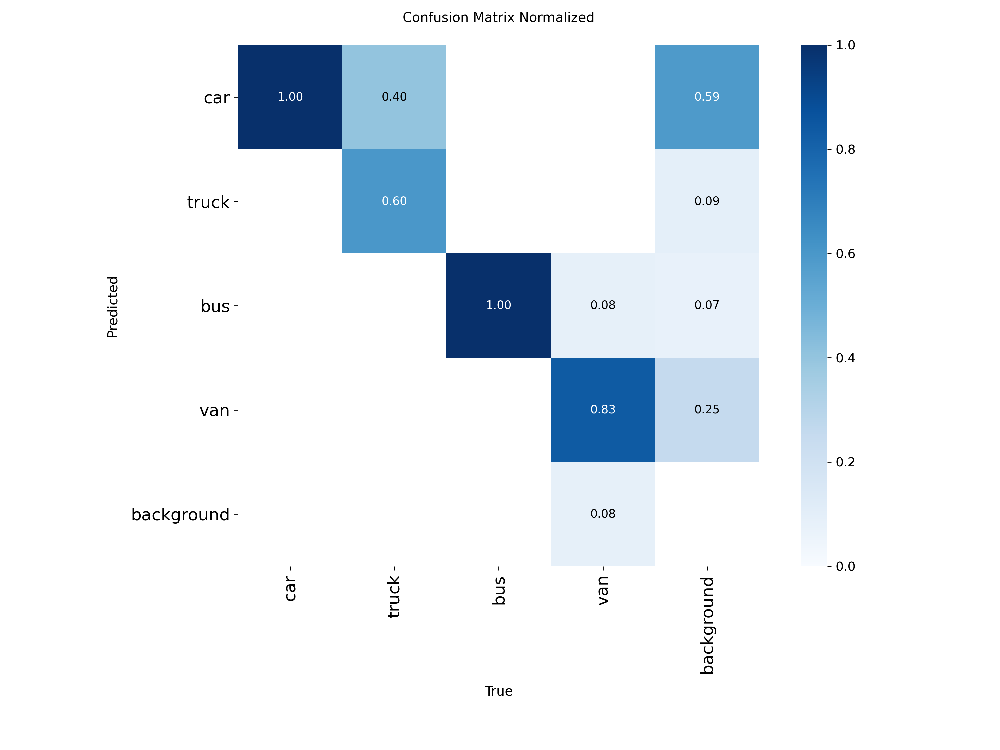

# Báo cáo cá nhân — Ngày 2 Object Detection

## 1. Thông tin học viên

- Họ tên: Hoàng Hải Đăng
- MSSV: 2A202603189
- Email:
- Lớp: K5-L2A
- Link repo bài làm: https://github.com/hoanghaidang1233/K5-L2A-DAY02-HoangHaiDang-2A202603189-ObjectDetection
- Link Colab đã chạy: https://colab.research.google.com/drive/190inFZaKsSsY9NeIKyWziIFa1mSIUCXZ

## 2. Schema và mini guideline

Chi tiết ở [GUIDELINE_MINI.md](../../GUIDELINE_MINI.md). Schema áp dụng đúng `data.yaml`: `car=0, truck=1, bus=2, van=3`; lớp mô tả loại xe, không mô tả trạng thái (xe đỗ vẫn gán nhãn).

Ba ca mơ hồ đã quyết định:

| Ảnh | Tình huống | Quyết định |
|---|---|---|
| `drive_015` | Nhiều xe đỗ sát nhau, xe trước che một phần xe sau | Mỗi xe một box theo phần nhìn thấy, không gộp |
| `drive_027` | Minivan ở xa, khó phân biệt `car`/`van` | Thân hộp vuông, nóc cao → `van`; dáng thuôn thấp → `car` |
| `drive_042` | Xe bị dải phân cách/cột đèn che ngang thân | Box phần thân nhìn thấy; bỏ qua xe máy, người đi bộ |

Phần cần giảng viên làm rõ:
- Gold dùng ID lớp khác schema (gold `1` = van, `2` = truck, `3` = bus), xem mục 4.
- Gold không gán nhãn xe đỗ ven đường, trong khi README yêu cầu "xe đang đỗ vẫn là `car`".

## 3. Annotation và self-QC

- Số file nhãn train: 50/50 (cùng basename với ảnh trong `dataset/images/train/`)
- Kết quả checker và lỗi đã xử lý: `python tools/check_yolo_labels.py` → "ĐẠT cấu trúc: 50/50 file nhãn hợp lệ"; không có lỗi định dạng cần xử lý.
- Danh sách ít nhất 10 ảnh đã rà bằng mắt (vẽ box của tôi chồng lên ảnh, kèm box gold sau khi được phát): `drive_001`, `drive_002`, `drive_008`, `drive_009`, `drive_012`, `drive_014`, `drive_021`, `drive_024`, `drive_028`, `drive_037`, `drive_049`.
- Lỗi bỏ sót/box/class phát hiện khi rà và cách sửa: không thấy box lỏng hay sai lớp theo schema (mean IoU với gold 0.95; mọi box truck/bus/van đúng loại xe khi xem ảnh). Khác biệt chính so với gold là quy ước ID lớp và việc gán nhãn xe đỗ (mục 4). Không sửa nhãn; bộ nhãn cuối giống commit khóa `b598013`.
- Commit khóa nhãn ban đầu: `b598013`

## 4. Gold QC và rework

| Chỉ số | Bản nộp (`b598013`) | Thử đổi ID theo gold (`4ad9ba4`, đã hoàn tác) |
|---|---:|---:|
| TP | 533 | 653 |
| FP | 229 | 109 |
| FN | 120 | 0 |
| Precision | 0.6995 | 0.8570 |
| Recall | 0.8162 | 1.0000 |
| F1 | 0.7534 | 0.9230 |
| mean_iou_of_matches | 0.9527 | 0.9553 |
| passed (ngưỡng script F1 ≥ 0.80) | false | true |

Kết quả chính thức: [`outputs/annotation_evaluation.json`](../../outputs/annotation_evaluation.json), chấm trên nhãn gốc `b598013`. Lab coach thông báo ngưỡng của lớp là F1 > 0.5, nên bộ nhãn này đạt để sang bước train.

**Phát hiện: gold train và eval lệch ID lớp so với schema.**

- So khớp không phân biệt lớp (IoU ≥ 0.5) cho thấy mọi box `truck/bus/van` của tôi đều khớp vị trí với gold, nhưng ID khác nhau theo một quy luật cố định, đúng 100% số box: gold `1` ↔ tôi `3`, gold `2` ↔ tôi `1`, gold `3` ↔ tôi `2`. Riêng `car` trùng hoàn toàn. Toàn bộ 120 FN và 120/229 FP đến từ quy luật này.
- Cắt ảnh các xe theo lớp gold để xem trực tiếp:

| Gold ghi | Xe thực tế trong ảnh (ví dụ) | Nhãn của tôi | Đúng theo schema |
|---|---|---|---|
| `truck` (1) | van/minibus màu bạc: `drive_002`, `drive_008`, `drive_021`, `drive_024`; minibus `drive_012` | `van` (3) | `van` |
| `bus` (2) | xe tải ben `drive_008`, xe tải thùng xanh `drive_009`, xe cứu hộ công an `drive_014`, xe bồn xanh `drive_037` | `truck` (1) | `truck` |
| `van` (3) | xe buýt thành phố `drive_002`, buýt nối toa vàng `drive_008`, buýt đỏ trắng `drive_009` | `bus` (2) | `bus` |

- Nhãn eval cũng lệch theo cùng quy luật. Ví dụ, xe buýt hai tầng giữa ảnh `drive_052` và xe buýt vàng bên trái `drive_058` được gold eval ghi là `van` (3).

**Quyết định:** giữ nguyên nhãn của tôi vì đúng với schema trong `data.yaml` (`car=0, truck=1, bus=2, van=3`). Không sửa gold, theo RULES.md. Lỗi lệch lớp của gold cần giảng viên/lab coach xác nhận.

**Lịch sử thay đổi:** lúc đầu tôi đã hiểu sai là mình xuất file sai thứ tự lớp, nên đổi ID cho khớp gold (commit `4ad9ba4`, F1 tăng lên 0.92). Sau khi xem lại ảnh và thấy gold mới là bên lệch, tôi hoàn tác về đúng nhãn gốc (commit `1461672`). Bảng trên giữ cả hai kết quả để đối chiếu. Mức F1 0.92 khi khớp ID cho thấy vị trí và độ phủ box của tôi tốt; phần chênh lệch đến từ cách đặt ID lớp.

**FP còn lại ngoài lỗi lệch lớp (109 box ở 31 ảnh, chủ yếu `car`).** Nhiều nhất ở `drive_001`, `drive_028`, `drive_049` (8 box mỗi ảnh), tiếp theo là `drive_002`, `drive_031`, `drive_043` (7 box).

- Chỉ 1/109 box chồng một phần lên box gold (IoU 0.1–0.5); 108 box còn lại nằm ở chỗ gold không có box nào. Vậy đây không phải box lỏng hay box trùng.
- Vẽ box của tôi và box gold lên `drive_001`, `drive_028`, `drive_049`: các box này gần như đều là **xe đỗ ven đường hoặc trong làn phụ** (hàng xe đỗ bên trái `drive_001` và `drive_049`, hai bên đường `drive_028`). Gold chỉ gán nhãn xe đang chạy trên làn chính.
- Theo kích thước và vị trí: 44 box rất nhỏ (< 0.2% diện tích ảnh), 48 box khác nằm ở phần trên ảnh (tâm box trong 35% chiều cao phía trên, tức xe ở xa), 16 box còn lại có kích thước và vị trí bình thường.
- **Quyết định: giữ các box này.** README ghi rõ "xe đang đỗ vẫn là `car`" và GUIDELINE_MINI.md (ca `drive_015`) cũng quyết định gán nhãn xe đỗ. Khác biệt đến từ phạm vi gán nhãn của gold, cần giảng viên xác nhận.

## 5. Kết quả YOLO

- Runtime, GPU/CPU, phiên bản Ultralytics và Torch: Google Colab, GPU Tesla T4 (15 GB), Python 3.13.16, Ultralytics 8.4.208, Torch 2.14.1+cu130. Notebook clone repo ở commit `1461672` (nhãn gốc, đúng schema).
- Các tham số thay đổi so với notebook nếu có và lý do: không thay đổi (yolo26n.pt, epochs=50, imgsz=640, batch=-1, seed=20260909).
- Đường dẫn best checkpoint trong phiên chạy: `/content/Day2-Lab/outputs/yolo26_runs/vehicle_annotation/weights/best.pt` (không commit file `.pt`).

| Chỉ số trên 10 ảnh eval | Giá trị |
|---|---:|
| Precision | 0.3156 |
| Recall | 0.3066 |
| mAP50 | 0.2740 |
| mAP50–95 | 0.2006 |

Chi tiết theo lớp (cell đánh giá `best_model.val` trên 10 ảnh eval), kèm lần chạy đối chứng trên nhãn đã đổi ID cho khớp gold (commit `4ad9ba4`, đã hoàn tác):

| Lớp | Instances (eval) | Precision | Recall | mAP50 | mAP50–95 | mAP50 khi nhãn train khớp ID gold |
|---|--:|--:|--:|--:|--:|--:|
| car | 94 | 0.629 | 0.777 | 0.738 | 0.521 | 0.886 |
| truck | 5 | 0.391 | 0.200 | 0.235 | 0.203 | 0.396 |
| bus | 2 | 0.000 | 0.000 | 0.008 | 0.003 | 0.524 |
| van | 12 | 0.243 | 0.250 | 0.115 | 0.075 | 0.768 |
| **all** | 113 | 0.316 | 0.307 | 0.274 | 0.201 | 0.644 |

Kết quả Colab (giải nén từ `day2_colab_outputs.zip`, đã bỏ file `.pt`):

- Ảnh dự đoán trên 10 ảnh eval (conf=0.25): [drive_051](assets/eval_predictions/visuals/drive_051.jpg) · [drive_052](assets/eval_predictions/visuals/drive_052.jpg) · [drive_053](assets/eval_predictions/visuals/drive_053.jpg) · [drive_054](assets/eval_predictions/visuals/drive_054.jpg) · [drive_055](assets/eval_predictions/visuals/drive_055.jpg) · [drive_056](assets/eval_predictions/visuals/drive_056.jpg) · [drive_057](assets/eval_predictions/visuals/drive_057.jpg) · [drive_058](assets/eval_predictions/visuals/drive_058.jpg) · [drive_059](assets/eval_predictions/visuals/drive_059.jpg) · [drive_060](assets/eval_predictions/visuals/drive_060.jpg)
- Log train theo epoch: [results.csv](assets/yolo26_runs/vehicle_annotation/results.csv), [results.png](assets/yolo26_runs/vehicle_annotation/results.png)
- Đánh giá best checkpoint: [confusion matrix](assets/yolo26_runs/vehicle_eval/confusion_matrix.png), [confusion matrix chuẩn hóa](assets/yolo26_runs/vehicle_eval/confusion_matrix_normalized.png), [PR curve](assets/yolo26_runs/vehicle_eval/BoxPR_curve.png), [F1 curve](assets/yolo26_runs/vehicle_eval/BoxF1_curve.png)
- So sánh nhãn gold và dự đoán trên batch eval: [val_batch0_labels.jpg](assets/yolo26_runs/vehicle_eval/val_batch0_labels.jpg) và [val_batch0_pred.jpg](assets/yolo26_runs/vehicle_eval/val_batch0_pred.jpg)

### Nhận xét kết quả

- **Ý nghĩa các chỉ số.** Precision 0.32: trong các box model vẽ ra, khoảng 1/3 khớp với gold (đúng vị trí và đúng ID). Recall 0.31: model tìm được khoảng 1/3 trong 113 xe của gold eval. mAP50 tính box đúng khi IoU ≥ 0.5; mAP50–95 lấy trung bình ở các ngưỡng IoU từ 0.50 đến 0.95, nên đo thêm độ sát của box.
- **`car` hoạt động bình thường** (mAP50 0.738, recall 0.777). Đây là lớp duy nhất mà nhãn train và gold eval dùng chung ID.
- **`truck/bus/van` gần như bằng 0 không phải vì model không nhận ra xe**, mà vì gold eval lệch ID lớp (mục 4). Model học theo schema nên gọi xe buýt là `bus`, còn gold eval ghi chính chiếc xe đó là `van`. Mỗi lần như vậy bị tính 1 FP + 1 FN. Ví dụ, `drive_052` có xe buýt hai tầng giữa ảnh: model dự đoán 1 `bus`, gold ghi `van`.
- **Phép đối chứng:** cùng ảnh, cùng model, cùng tham số, chỉ đổi ID nhãn train cho khớp gold thì mAP50 tăng từ 0.274 lên 0.644; bus từ 0.008 lên 0.524, van từ 0.115 lên 0.768. Riêng `car` cũng tăng (0.738 → 0.886). Như vậy chỉ số model phụ thuộc trực tiếp vào việc nhãn train và nhãn đánh giá có dùng chung quy ước lớp hay không.

### Trả lời bốn câu hỏi cuối notebook

1. **Lớp nào recall thấp nhất? Ảnh nào minh họa?** `bus`, recall 0.0. Gold eval chỉ có 2 box `bus`: góc trên bên phải `drive_051` và mép phải `drive_058`. Xem ảnh thì cả hai đều là xe tải (xe tải thùng ở `drive_051`, xe cứu hộ ở `drive_058`), nên model, vốn học `truck` cho loại xe này, không bao giờ khớp được lớp `bus` của gold. Chỉ có 2 instance nên recall của lớp này rất nhạy: thêm hoặc bớt 1 xe là thay đổi 50%.
2. **Nếu mAP50 cao nhưng mAP50–95 thấp, cần kiểm điều gì trên box?** Khi đó model tìm đúng chỗ có xe nhưng box chưa sát mép: lệch tâm, rộng hoặc hẹp hơn xe, nhất là với xe nhỏ ở xa và xe bị che. Ở đây `car` có mAP50 0.738 nhưng mAP50–95 0.521, nên cần kiểm độ khít box ở các xe nhỏ phía xa (ví dụ hàng xe phía trên ảnh `drive_058`) và kiểm guideline về box cho xe bị che hoặc cắt khung.
3. **Lỗi class nào có thể liên quan guideline? Dữ kiện nào hỗ trợ nhận xét?** Lỗi lớn nhất là quy ước ID giữa gold và schema: gold `1` là van, `2` là truck, `3` là bus. Dữ kiện: 100% box truck/bus/van khớp vị trí nhưng lệch ID theo một quy luật cố định, và ảnh cắt xác nhận (xem bảng mục 4). Ngoài ra còn ranh giới `van`/`car` với minivan và SUV (ca `drive_027` trong GUIDELINE_MINI.md); ví dụ, xe gold ghi ở `drive_053` là một minivan tối màu, rất dễ bị gán `car`.
4. **Vì sao không dùng 10 ảnh eval để train? Vai trò validation của chúng trong notebook là gì?** Nếu train trên eval thì model đã "thấy đáp án", chỉ số sẽ không phản ánh khả năng tổng quát trên ảnh mới. Trong notebook, 10 ảnh eval đóng vai trò validation: được dùng sau mỗi epoch để chọn `best.pt`, rồi lại dùng để báo cáo chỉ số. Vì vậy kết quả hơi lạc quan và không phải test set độc lập.

## 6. Khó khăn và cách xử lý

| Bước/thời điểm | Lỗi quan sát | Cách đã thử | Kết quả/còn thiếu |
|---|---|---|---|
| CP5 — Gold QC | F1 = 0.7534 < 0.80 (ngưỡng script). Mọi box truck/bus/van lệch ID so với gold theo quy luật cố định. | Ban đầu cho rằng mình xuất sai thứ tự lớp nên đổi ID cho khớp gold (`4ad9ba4`). Sau đó cắt ảnh từng lớp gold để xem trực tiếp. | Phát hiện gold train và eval mới là bên lệch ID. Đã hoàn tác về nhãn gốc (`1461672`); cần báo giảng viên. |
| CP6 — Colab | Lần chạy đầu dùng CPU (chậm). Notebook bật chế độ private outputs. | Chuyển runtime sang GPU T4, xóa runtime và chạy lại toàn bộ notebook mỗi khi nhãn thay đổi. | Kết quả cuối ở mục 5 là lần chạy trên `1461672`. |

## 7. Tự đánh giá theo rubric

Đối chiếu [RUBRIC.md](../../RUBRIC.md):

| Tiêu chí | Kết quả bài làm | Còn thiếu / chưa kiểm được |
|---|---|---|
| Hoàn thành và định dạng YOLO (10) | 50/50 file, checker đạt | — |
| Đầy đủ vật thể (20) | Recall với gold 0.82 (1.00 khi bỏ qua lệch ID); có gán cả xe đỗ | Chưa kiểm hết xe rất nhỏ ở xa |
| Độ bám sát và hình học box (20) | Mean IoU với gold 0.95 | — |
| Phân lớp nhất quán (15) | Box truck/bus/van đúng loại xe khi xem ảnh, theo `data.yaml` | Gold dùng quy ước ID khác, cần giảng viên xác nhận |
| Mini guideline (10) | Định nghĩa 4 lớp, quy tắc box, 3 ca mơ hồ có lý do | — |
| Gold-set QC (15) | F1 0.7534, mean IoU 0.9527; có phân tích nguyên nhân và quá trình sửa/hoàn tác | Chưa đạt ngưỡng 0.80 của script; coach cho ngưỡng > 0.5 |
| Pipeline YOLO và phân tích (10) | Colab chạy trên GPU, giữ đúng split, có metrics, ảnh eval và phân tích | mAP các lớp truck/bus/van thấp do lệch ID với gold eval |

## 8. Công cụ AI và tài liệu tham khảo

- Claude Code (Anthropic): dùng ở bước gold QC và báo cáo. Cụ thể: phân tích `annotation_evaluation.json`, so khớp không phân biệt lớp, cắt ảnh theo lớp gold để kiểm tra, viết script đổi ID rồi hoàn tác, chạy lại notebook Colab, và soạn nháp mục 2–7 của báo cáo từ số liệu thực tế. Bước gán nhãn, vẽ box và guideline là tự làm.
- Lưu ý: AI ban đầu đã kết luận sai nguyên nhân (cho rằng nhãn của tôi xuất sai thứ tự lớp). Kết luận này được sửa lại sau khi xem trực tiếp ảnh từng lớp gold.
- Các ảnh trong mục 3–5 được rà bằng ảnh có vẽ box chồng lên (AI hỗ trợ tạo ảnh cắt và ảnh vẽ box).
- Không dùng tài liệu ngoài repo.
